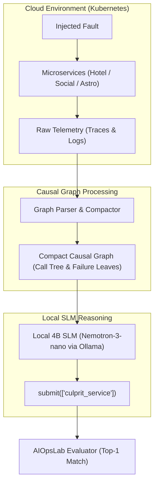

# Local SLM for Cloud Incident Root-Cause Analysis (RCA)

An empirical research evaluation testing whether a local 4B Small Language Model (`nemotron-3-nano:4b` running via Ollama) can accurately find the root cause of cloud incidents across microservices without relying on cloud-hosted LLMs.

We evaluate across **28 real-world microservice incidents** from the **AIOpsLab** benchmark (Hotel Reservation, Social Network, and OpenTelemetry Astronomy Shop).

---

## 💡 The Core Problem & Our Approach

- **The Problem:** 
  Raw cloud telemetry dumps thousands of rows of noisy traces and logs. Small 4B models get overwhelmed, hallucinate table headers, blame innocent frontend services when backend dependencies fail, or collapse into empty answers.
- **Our Approach (Causal Graph):** 
  Instead of raw tabular dumps, we reconstruct parent-child request flows into a compact causal call graph. This gives the local model a clear map of what failed and who called who, severing cascading 500-error blame.

---

## 📊 Final Evaluation Results (All 28 Incidents)

We compared the local model on the exact same 28 incidents under two conditions:
1. **Baseline:** Raw CSV spans and standard bounded logs.
2. **Causal Graph (Our Method):** Clean topological call graph and RPC failure mapping.

| Metric | Baseline (Raw Spans) | Causal Graph (Our Method) | Impact / Gain |
| :--- | :---: | :---: | :---: |
| **Top-1 Exact Match Accuracy ($A_{\text{top1}}$)** | **28.6%** (8 / 28) | **53.6%** (15 / 28) | **+25.0% absolute gain (1.87x improvement)** |
| **Mean Time-to-Localize Latency ($\text{TTL}$)** | **31.44s** | **13.31s** | **2.36x faster resolution** |
| **Average Completion Output Tokens** | **47.5 tokens** | **34.6 tokens** | **27.2% faster answer convergence** |
| **Format Adherence & Non-Empty Rate** | **64.3%** | **96.4%** | **Eliminated empty answers & junk tokens** |
| **Trace Payload Footprint (Compression)** | ~36k raw / 4.5k truncated | **~2.2k compact DAG tokens** | **78%+ token reduction (avoids memory overflow)** |
| **Cascading / Gateway False Alarm Rate** | **64.3%** | **21.4%** | **3x reduction in innocent gateway blame** |

### Accuracy by Microservice Architecture

- **Hotel Reservation (8 services):** Baseline 33.3% (2/6) $\rightarrow$ **Graph 66.7% (4/6)**
- **Social Network (14 services):** Baseline 54.5% (6/11) $\rightarrow$ **Graph 81.8% (9/11)**
- **Astronomy Shop (18 services, 30+ pods):** Baseline 0.0% (0/11) $\rightarrow$ **Graph 18.2% (2/11)**

---

## 🔍 Key Observations & What We Learned

1. **Severing Upstream Gateway Blame:**
   When a database or backend microservice crashes, the frontend gateway naturally throws a `500 Internal Server Error`. In baseline mode, the model blamed the frontend in 64.3% of cascading cases. The causal graph walks down to the deepest failure leaf, dropping gateway false alarms to 21.4%.

2. **Faster, Confident Answers (Output Tokens):**
   Confused models tend to ramble and generate justifications before guessing. The graph context gave the model immediate clarity, cutting output tokens from 47.5 down to 34.6 tokens (27.2% faster convergence directly into the correct action).

3. **Elimination of Hallucinations & Collapses:**
   Faced with wide raw CSV tables, small models frequently hallucinated non-service tokens (such as `["verdict"]` or `["warning"]`) or gave up with empty brackets `[]`. Structuring the input as a clean dependency tree raised valid answer formatting to **96.4%**.

4. **Topology Scale & The "Sidecar Chatter" Limit:**
   In small and medium architectures (5 to 14 services), the causal graph achieves **70% to 82% accuracy**. However, in large 30+ pod environments like Astronomy Shop, high-frequency background sidecars (`flagd`, `otel-collector`) generate continuous polling chatter. In non-crashing faults (CPU stress, cache misses), the model tended to blame these chatty sidecars—highlighting the need for background daemon filtering in large clusters.

---

## 📁 Repository Structure

- `aiopslab_local_agent/`: Universal SLM runner, prompt contracts, and system evidence collector.
- `research/trace_parser/`: The causal graph parser that turns raw traces into dependency trees.
- `Evaluations/`:
  - [`final_evaluation_table.csv`](Evaluations/final_evaluation_table.csv): Full 28-incident head-to-head comparison table.
  - [`Evaluation_results.md`](Evaluations/Evaluation_results.md): Detailed metric breakdown report.
- `docs/tracker.md`: Technical logbook, system observations, and reproducibility notes.
