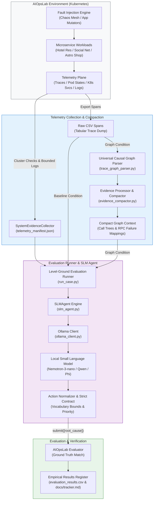

# AIOpsLab: Local SLM for Cloud Incident Root-Cause Analysis (RCA)

An empirical research framework evaluating local **Small Language Models (SLMs: Nemotron-3-nano:4b, Qwen-2.5-Coder:7b, Phi-4-mini)** on automated cloud incident root-cause localization (RCA) across microservice architectures (Hotel Reservation, Social Network, Astronomy Shop).

The project investigates whether **domain-specific topological causal graph parsing** can bridge the reasoning gap of resource-constrained local models against noisy raw distributed telemetry, achieving deterministic 1-step localization without cloud-scale LLMs.

---

## 🔬 Core Research Hypotheses & Findings

1. **The "Silent Service" Telemetry Blindspot:**
   - When a microservice container is abruptly killed or fails to start, it produces **0 distributed trace spans**.
   - Trace-only diagnostic pipelines commit systematic false-positive errors (blaming the calling upstream frontend). Correlating cluster orchestrator state (kubectl get pods, kubectl get endpoints, service port configurations) with request traces is mandatory for robust RCA.

2. **Graph-Augmented Evidence vs. Raw Context Overflow:**
   - Ingesting raw CSV spans (70,000+ characters) causes extreme attention dilution ("Lost in the Middle") and prompt inflation in local SLMs, leading to inference timeouts or caller-blame hallucinations.
   - The causal graph parser (trace_graph_parser.py + evidence_compactor.py) compacts raw spans by **~80-90%** into call trees and RPC target attribution tables, transforming multi-hop trace reasoning into a direct classification task.

3. **Level-Ground Scientific Evaluation:**
   - Baseline and Graph conditions share **identical** cluster platform telemetry and bounded logs. The single independent variable is:
     - **Baseline:** Raw Tabular CSV Trace Spans
     - **Graph (Proposed Method):** Causal Dependency Graph (slm_context_compact.txt)

---

## 📊 Benchmark Highlights & Progress

### 1. Head-to-Head Comparison: Raw Spans vs. Causal Graph
Evaluated under identical cluster conditions using 
emotron-3-nano:4b on container_kill-localization:

| Evaluation Metric | Baseline Condition (Raw CSV Spans) | Graph Condition (Causal Graph Parser) | Relative Improvement |
| :--- | :---: | :---: | :---: |
| **Prediction** | ["frontend"] (Caller Blame) | ["geo"] (True Root Cause) | **Exact Match** |
| **Accuracy** | **0.0%** | **100.0%** | **+100.0% Gain** |
| **Time to Localize (TTL)** | 23.42s | **7.56s** | **3.1x Faster Inference** |
| **Steps** | 1 | 1 | Deterministic 1-step resolution |
| **Failure Analysis** | Copied raw CSV table tokens | Disambiguated caller from callee target | **Eliminated caller hallucination** |

---

### 2. Verified Benchmark Evaluation Matrix (Baseline vs. Graph)

The matrix below captures verified head-to-head comparisons and baseline evaluation runs conducted with `nemotron-3-nano:4b`:

| Incident ID | Microservice Benchmark | Fault Injected | Condition | Model Output | Accuracy | TTL | Steps | Result Note |
| :--- | :--- | :--- | :---: | :---: | :---: | :---: | :---: | :--- |
| `container_kill-localization` | Hotel Reservation | Container Kill | Baseline | `["frontend"]` | **0.0%** | 23.42s | 1 | Upstream caller blame from raw CSV spans |
| `container_kill-localization` | Hotel Reservation | Container Kill | **Graph** | `["geo"]` | **100.0%** | **7.56s** | 1 | **Exact match, 3.1x faster** |
| `k8s_target_port-misconfig-localization-1` | Social Network | K8s Port Mismatch | **Graph** | `["user-service"]` | **100.0%** | **13.69s** | 1 | **Exact match via declarative manifest** |
| `pod_kill_hotel_res-localization-1` | Hotel Reservation | Pod Kill | Baseline | `["user"]` | **100.0%** | 34.35s | 1 | Cluster state detected restart count [!] ATTENTION |
| `pod_kill_hotel_res-localization-1` | Hotel Reservation | Pod Kill | **Graph** | `["user"]` | **100.0%** | **21.42s** | 1 | **Exact match via orchestrator restart signals** |
| `misconfig_app_hotel_res-localization-1` | Hotel Reservation | App Misconfig | Baseline | `["verdict", "verdict_reason"]` | **0.0%** | 22.39s | 1 | Raw CSV schema header leakage |
| `misconfig_app_hotel_res-localization-1` | Hotel Reservation | App Misconfig | **Graph** | `["geo"]` | **100.0%** | **16.84s** | 1 | **Exact match via RPC callee attribution** |
| `pod_failure_hotel_res-localization-1` | Hotel Reservation | Pod Failure | Baseline | `[]` | **0.0%** | 25.36s | 1 | Pods stayed 1/1 Running; fallback to empty submission |
| `network_delay_hotel_res-localization-1` | Hotel Reservation | Network Delay | Baseline | `[]` | **0.0%** | 25.54s | 1 | Latency-only degradation; no crash signals |
| `network_loss_hotel_res-localization-1` | Hotel Reservation | Network Loss | Baseline | `["frontend", "profile", "rate", "reservation"]` | **0.0%** | 38.10s | 1 | Multi-service error cascade; caller penalty |
| `auth_miss_mongodb-localization-1` | Social Network | Auth Miss | Baseline | `["url-shorten-mongodb"]` | **100.0%** | **19.43s** | 1 | Explicit auth keyword match in Mongo logs |
| `revoke_auth_mongodb-localization-1` | Hotel Reservation | Revoke Auth | Baseline | `["geo", "search"]` | **50.0%** | 20.63s | 1 | Listed caller + callee; subset penalty |
| `revoke_auth_mongodb-localization-2` | Hotel Reservation | Revoke Auth | Baseline | `["rate"]` | **100.0%** | **18.77s** | 1 | Exact match localized to rate DB |
| `user_unregistered_mongodb-localization-1` | Hotel Reservation | Unregistered User | Baseline | `{}` -> `[]` | **0.0%** | 175.43s | 1 | Model formatted response as empty JSON dict |
| `user_unregistered_mongodb-localization-2` | Hotel Reservation | Unregistered User | Baseline | `["rate"]` | **100.0%** | **113.29s** | 1 | Accurately extracted root error service |
| `k8s_target_port-misconfig-localization-2` | Social Network | Port Misconfig | Baseline | `[]` | **0.0%** | 13.13s | 1 | TargetPort mismatch missed in raw prompt |
| `k8s_target_port-misconfig-localization-3` | Social Network | Port Misconfig | Baseline | `["post-storage-service"]` | **100.0%** | **7.72s** | 1 | Exact match via targetPort mismatch signal |
| `scale_pod_zero_social_net-localization-1` | Social Network | Scale to Zero | Baseline | `["user-service"]` | **100.0%** | **9.13s** | 1 | Deployment replicas 0/1 signal [!] ATTENTION |
| `assign_to_non_existent_node_social_net-localization-1` | Social Network | Bad Node Assign | Baseline | `["user-service"]` | **100.0%** | **12.53s** | 1 | Pod stuck Pending (0/1 ready) [!] ATTENTION |

---

### 3. Empirical 17-Incident Sequential Baseline Batch Evaluation Summary

Across a 17-incident sequential baseline evaluation batch run with 
emotron-3-nano:4b:
- **Total Evaluated Incidents:** 17
- **Exact Matches (100% Accuracy):** 8 (47.1%)
- **Partial / Subset Matches (50% Accuracy):** 1 (5.9%)
- **Failures (0.0% Accuracy):** 8 (47.1%)
- **Key Baseline Failure Categories Identified:**
  - *Cascading Caller Blame:* Network loss and database auth drops caused upstream callers (rontend, 
eservation) to emit 5xx errors; the model penalized accuracy by submitting all callers.
  - *Schema Key Hallucination:* On unstructured app errors, 4B models copied raw CSV table headers ("verdict", "verdict_reason") or log severity strings ("warning").
  - *Silent Latency Degradation:* Network delay faults left pods in 1/1 Running state with 0 restarts; without graph call trees, the baseline model defaulted to empty submissions ([]).

---

## 🏗️ Repository Architecture & Telemetry Pipeline

### Module Organization

| Directory / File | Responsibility |
| :--- | :--- |
| **`aiopslab_local_agent/slm_agent.py`** | Universal `SLMAgent` implementation supporting Nemotron, Qwen, and Phi; handles prompt format contracts, candidate vocabulary extraction, and anomaly-priority normalization. |
| **`aiopslab_local_agent/system_evidence_collector.py`** | Declarative aggregator querying live Kubernetes cluster signals (pod restarts, port mismatches, scale-to-zero, endpoints) and bounded logs. |
| **`aiopslab_local_agent/telemetry_manifest.json`** | Declarative configuration catalog of Kubernetes commandlets, parameters, log limits, and error keywords. |
| **`aiopslab_local_agent/evidence_compactor.py`** | Summarizes parsed traces, compacts graph context, and enforces token budget safety ceilings. |
| **`aiopslab_local_agent/run_case.py`** | Automated single-incident test runner orchestrating baseline and graph evaluation conditions. |
| **`aiopslab_local_agent/ollama_client.py`** | Local Ollama inference client recording prompt/completion token usage and latency. |
| **`aiopslab_bridge/`** | REST HTTP API bridge wrapping the AIOpsLab orchestrator for decoupled agents. |
| **`research/trace_parser/trace_graph_parser.py`** | Universal causal graph parser reconstructing transaction call trees and RPC target attribution tables. |
| **`docs/tracker.md`** | Comprehensive project tracker, thesis findings register, failure analyses, and WSL batch scripts. |
| **`evaluation_results.csv`** | Primary empirical benchmark dataset recording accuracy, TTL, step counts, and token metrics. |

---
## 🚀 Getting Started & Execution

### Prerequisites
- Python 3.10+
- Running Kubernetes cluster (Minikube / Kind / K3s) with AIOpsLab installed
- Locally running [Ollama](https://ollama.ai/) instance with target SLM loaded (e.g. 
emotron-3-nano:4b)

### Single Incident Execution

Run an incident under **Graph** mode:
`ash
python3 -m aiopslab_local_agent.run_case \
    --problem-id container_kill-localization \
    --condition graph \
    --model nemotron-3-nano:4b \
    --ollama-host http://127.0.0.1:11434 \
    --max-steps 1
`

Run an incident under **Baseline** mode:
`ash
python3 -m aiopslab_local_agent.run_case \
    --problem-id container_kill-localization \
    --condition baseline \
    --model nemotron-3-nano:4b \
    --ollama-host http://127.0.0.1:11434 \
    --max-steps 1
`

### Complete Incident Catalog (28 Incidents)
The full test suite encompasses 28 active incidents across three microservice platforms:
- **Hotel Reservation (11):** container_kill, pod_kill, misconfig_app, 
etwork_loss, 
etwork_delay, 
etwork_corrupt, 
etwork_duplicate, cpu_hog (1 & 2), mem_hog (1 & 2).
- **Social Network (6):** k8s_target_port-misconfig, scale_pod_zero, uth_miss_mongodb, wrong_bin_usage (1, 2, & 3).
- **Astronomy Shop (11):** payment_service_unreachable, kafka_queue_problems, loadgenerator_flood, raud_detection_failure, 
ecommendation_cache_failure, productcatalog_failure, shipping_service_slow, email_service_failure, currency_service_failure, d_service_failure, cart_service_failure.

For batch execution bash scripts and complete experimental details, see [docs/tracker.md](docs/tracker.md).

